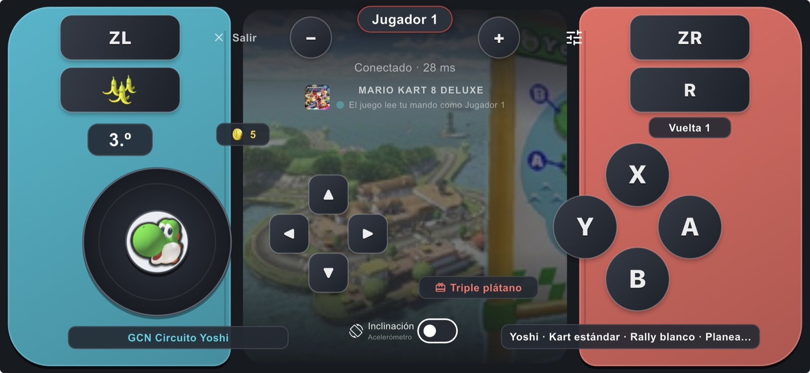

# Mando NX

Your phone as a Wi‑Fi controller for Nintendo Switch games that run natively on your Mac with [nxnative](https://github.com/seedds/nxnative). Each phone is a player: for example Mario Kart 8 Deluxe with 4 players in split screen, with up to three or four phones and the Mac's keyboard.



*A race of Mario Kart 8 Deluxe on an iPhone 14: the course's picture fills the middle screen, the character rides the stick, the item you hold sits on L (the button that uses it), and the place, lap, coins, course, kart and items sit in the gaps between the controls.*

## What it does

- **Buttons your way:** move and resize every button, pick a layout (*Clásico*, *Mario Kart*, *Zurdo* for left hands, *Grande* for large buttons) or save your own.
- **Two looks:** *Consola* (cyan and coral sides around a dark screen) and *Gamer clásico* (the dark blue neon look). Chosen on the connect screen or in Ajustes; your layouts and sensor settings stay as they are.
- **The game on the phone:** its icon and name, **who plays** in each seat, a dot that beats while **the game is reading your controller**, and **typing on the phone** when the game asks for text.
- **The race on the phone** (Mario Kart 8 Deluxe 4.0.1): your place, lap and coins, the course by its Spanish name, your character and kart, and the items you hold. With the game's own pictures: the course's picture on the middle screen, your character's face on the stick, the held item on L, the game's coin. The Mac makes them from your own copy of the game while you play; none are in this repository.
- **Steering with the gyroscope** when the phone has one (more precise), corrected by the accelerometer.
- **Flutter app (iOS and Android, Spanish UI):** a landscape touch pad with a floating stick, A B X Y, L R ZL ZR, + −, the D-pad and any number of fingers at once. Connect with a **QR code** or by hand (IP, port, code). **Tilt steering** (with calibration and sensitivity), **the game's own rumble**, and a **Probar mando** mode that works offline.
- **Mac host (a patch for nxnative):**
  - takes up to 8 phones over UDP, with a pairing code and safe sessions;
  - shares the players with the keyboard and physical controllers;
  - shows the QR code (⌘J) and lets you change the keyboard's keys in a window (⌘K).
- **Scripts:** set up nxnative, build the host for your game, start the game, install the app on your iPhone and check everything.

## How it works

```
 iPhone / Android                         Mac (nxnative + patch)                     Game
┌──────────────┐  hello / state 60 Hz   ┌───────────────────────────┐   npad 1..8   ┌──────────────┐
│  Mando NX    │ ─────────────────────▶ │ dmhost-wifi               │ ────────────▶ │ the game's   │
│  (app/)      │ ◀───────────────────── │ remote_mac.c / hle_hid.c  │ ◀──────────── │ native code  │
└──────────────┘  welcome, ack, rumble, └───────────────────────────┘  rumble, the   └──────────────┘
                  info, race, pictures                                 controllers it takes
                  (UDP, JSON)
```

nxnative is what turns your game (your NSPs and your `prod.keys`) into something that runs on the Mac. This repository **does not contain nxnative**: `scripts/setup_nxnative.sh` downloads the tested version (`host/NXNATIVE_COMMIT`) and applies `host/nxnative.patch` to it.

## Quick start

You need a Mac with Apple silicon, macOS 26.6 or later, Xcode 27.1, [Homebrew](https://brew.sh), Python 3.12 or later and [Flutter](https://docs.flutter.dev/get-started/install/macos) 3.47 or later. Also an iPhone or iPad (by cable the first time), your Apple ID in Xcode and **your own copy** of the game.

```bash
git clone https://github.com/JoelSoy/mando-nx.git && cd mando-nx
scripts/setup_nxnative.sh                         # nxnative + the patch (in ../nxnative)
# once: nxnative's tools (the step above prints them), then pack your game:
python3 ../nxnative/scripts/build_ipa_from_nsp.py ~/Games/MarioKart -k ~/keys/prod.keys
scripts/build_host.sh --build ~/Games/MarioKart/0100152000022000_build --test
scripts/install_ios.sh                            # the app on your iPhone
scripts/play_wifi.command                         # the game, with the QR code on screen
```

On the phone: **Escanear QR del Mac** → **Conectar**. The first phone is **Player 1**.

## Documentation

The guides are in Spanish, like the app.

| | |
|---|---|
| [docs/instalacion.md](docs/instalacion.md) | The full setup, step by step, and what each script does |
| [docs/jugar.md](docs/jugar.md) | Connecting, players, controls, tilt, rumble, the game card, the race, the keyboard's keys |
| [docs/problemas.md](docs/problemas.md) | "Sin respuesta del Mac" and other problems, with their fixes |
| [docs/ingenieria_inversa.md](docs/ingenieria_inversa.md) | How the race data and the pictures were found in Mario Kart 8 Deluxe |
| [docs/protocol.md](docs/protocol.md) | The Wi‑Fi protocol and the host's switches (in English; a copy of nxnative's `docs/wifi-controllers.md` with the patch) |
| [AGENTS.md](AGENTS.md) | For AI agents and developers: the code map, the rules and how to change each part |

## Layout

```
app/                  The Flutter app "Mando NX" (lib/, test/, ios/, android/)
host/nxnative.patch   The changes to nxnative's host (C / Objective-C, tests, docs)
host/NXNATIVE_COMMIT  The nxnative version the patch applies to
scripts/              setup_nxnative.sh, build_host.sh, play_wifi.command, install_ios.sh, check.sh, smoke_host.sh, export_patch.sh
docs/                 Guides in Spanish, the protocol, images
```

## Status

Tested with **Mario Kart 8 Deluxe** (update 4.0.1) on a Mac with Apple silicon and an **iPhone 14 with iOS 26.5**: connecting, 4 players (in real play and with simulated phones), the game card, and the race data with the game's pictures (above). Not tested yet: Android on a real phone; the feel of tilt and rumble over a long session; the race data of players 2–4 in split screen (items only go to player 1 playing alone). Booster Course Pass courses have no picture yet. The patch is made for nxnative `ce99604`; to move it to a newer version, follow [AGENTS.md](AGENTS.md#moving-to-a-newer-nxnative).

## Legal

There are no files of any game here, no keys and nothing extracted from a game, and there must never be: everyone uses their own copy. The pictures the phone shows are made on your Mac from your copy while you play. Not affiliated with Nintendo or nxnative. MIT license ([LICENSE](LICENSE)). The patch modifies nxnative, which is also MIT (© seedds).
