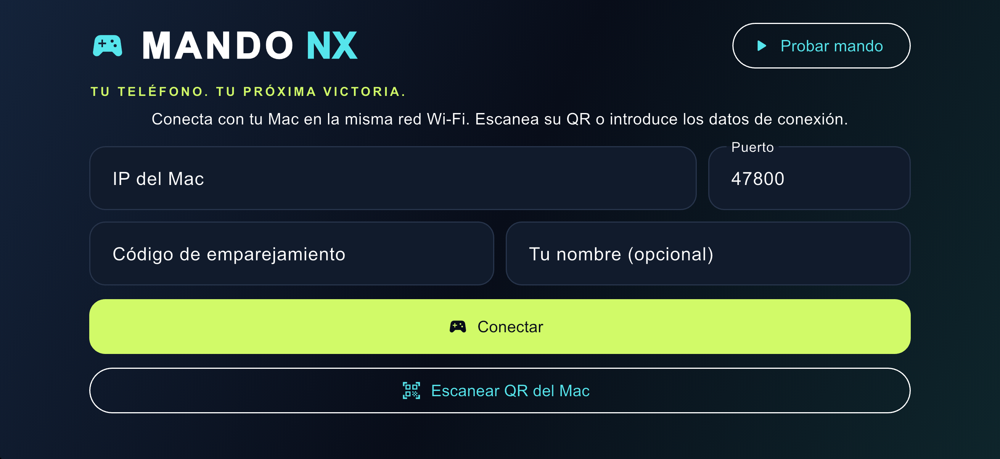

# Mando NX

Tu teléfono como mando, por Wi‑Fi, de los juegos de Nintendo Switch que corren de forma nativa en tu Mac con [nxnative](https://github.com/seedds/nxnative). Cada teléfono es un jugador: por ejemplo Mario Kart 8 Deluxe a 4 jugadores en pantalla dividida, con hasta tres o cuatro teléfonos y el teclado del Mac.



## Qué tiene

- **App Flutter (iOS y Android, en español):** mando táctil apaisado con joystick flotante, A B X Y, L R ZL ZR, + −, cruceta y varios dedos a la vez. Conexión por **QR** o a mano (IP, puerto, código), **volante por inclinación** (acelerómetro, con calibración y sensibilidad), **vibración real del juego** y un modo **Probar mando** sin conexión.
- **Tarjeta del juego en el mando:** el nombre del juego, una luz por cada jugador que admite la partida y lo que el juego hace con tu mando: si lo lee como tu propio jugador, si estás en una pantalla de 1 jugador, si espera turno o si el juego está en pausa.
- **Host del Mac (parche para nxnative):**
  - recibe hasta 8 teléfonos por UDP con código de emparejamiento y sesiones seguras;
  - reparte los jugadores junto al teclado y a los mandos físicos;
  - muestra el QR (⌘J) y deja cambiar las teclas del teclado en una ventana (⌘K).
- **Scripts:** preparan nxnative, compilan el host para tu juego, lanzan el juego, instalan la app en tu iPhone y lo prueban todo.

## Cómo funciona

```
 iPhone / Android                         Mac (nxnative + parche)                    Juego
┌──────────────┐  hello / state 60 Hz   ┌───────────────────────────┐   npad 1..8   ┌──────────────┐
│  Mando NX    │ ─────────────────────▶ │ dmhost-wifi               │ ────────────▶ │ código nativo│
│  (app/)      │ ◀───────────────────── │ remote_mac.c / hle_hid.c  │ ◀──────────── │ del juego    │
└──────────────┘  welcome, ack, rumble, └───────────────────────────┘  vibración,   └──────────────┘
                  info (UDP, JSON)                                    mandos que acepta
```

nxnative es lo que convierte tu juego (tus NSP y tu `prod.keys`) en algo que corre en el Mac. Este repositorio **no contiene nxnative**: el script `scripts/setup_nxnative.sh` lo descarga en la versión probada (`host/NXNATIVE_COMMIT`) y le aplica `host/nxnative.patch`.

## Inicio rápido

Requisitos: un Mac con Apple silicon, macOS 26.6 o posterior, Xcode 27.1, [Homebrew](https://brew.sh), Python 3.12 o posterior y [Flutter](https://docs.flutter.dev/get-started/install/macos) 3.47 o posterior. También un iPhone o iPad conectado por cable, tu Apple ID en Xcode y **tu propia copia** del juego.

```bash
git clone https://github.com/JoelSoy/mando-nx.git && cd mando-nx
scripts/setup_nxnative.sh                         # nxnative + parche (en ../nxnative)
# una vez: las herramientas de nxnative (las imprime el paso anterior), luego empaca tu juego:
python3 ../nxnative/scripts/build_ipa_from_nsp.py ~/Games/MarioKart -k ~/keys/prod.keys
scripts/build_host.sh --build ~/Games/MarioKart/0100152000022000_build --test
scripts/install_ios.sh                            # la app en tu iPhone conectado
scripts/play_wifi.command                         # el juego, con el QR en pantalla
```

En el teléfono: **Escanear QR del Mac** → **Conectar**. El primer teléfono es el **Jugador 1**.

## Documentación

| | |
|---|---|
| [docs/instalacion.md](docs/instalacion.md) | La instalación completa, paso a paso, y qué hace cada script |
| [docs/jugar.md](docs/jugar.md) | Conectar, jugadores, controles, inclinación, vibración, la tarjeta del juego, teclas del teclado |
| [docs/problemas.md](docs/problemas.md) | "Sin respuesta del Mac" y otros problemas, con su solución |
| [docs/protocol.md](docs/protocol.md) | El protocolo Wi‑Fi y los interruptores del host (en inglés; copia de `docs/wifi-controllers.md` de nxnative con el parche) |
| [AGENTS.md](AGENTS.md) | Para agentes de IA y desarrolladores: mapa del código, reglas y cómo cambiar cada parte |

## Estructura

```
app/                  La app Flutter "Mando NX" (lib/, test/, ios/, android/)
host/nxnative.patch   Los cambios al host de nxnative (C / Objective-C, tests, docs)
host/NXNATIVE_COMMIT  La versión de nxnative a la que se aplica el parche
scripts/              setup_nxnative.sh, build_host.sh, play_wifi.command, install_ios.sh, check.sh, smoke_host.sh, export_patch.sh
docs/                 Guías en español y el protocolo
```

## Estado

Probado con **Mario Kart 8 Deluxe** (actualización 4.0.1) en un Mac con Apple silicon y un **iPhone 14 con iOS 26.5**: conexión, 4 jugadores (en pruebas reales y con teléfonos simulados) y la tarjeta del juego. Sin probar todavía: Android en un teléfono real, y cómo se sienten la inclinación y la vibración a lo largo de una partida. El parche está hecho para nxnative `ce99604`. Para pasarlo a una versión más nueva, sigue [AGENTS.md](AGENTS.md#moving-to-a-newer-nxnative).

## Legal

Aquí no hay ningún archivo de ningún juego, ninguna clave ni nada extraído de un juego, y nunca debe haberlo: cada persona usa su propia copia. No tiene relación con Nintendo ni con nxnative. Licencia MIT ([LICENSE](LICENSE)). El parche modifica nxnative, que también es MIT (© seedds).
