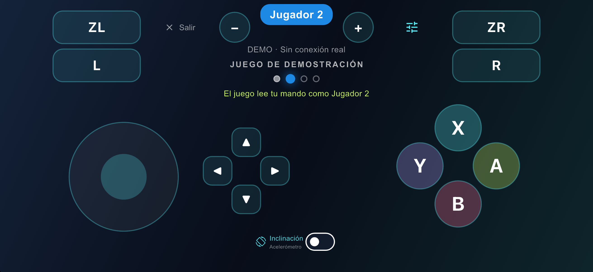

# Jugar

## Abrir el juego

Doble clic en `scripts/play_wifi.command`, o desde Terminal:

```bash
scripts/play_wifi.command                  # el juego que guardó build_host.sh
scripts/play_wifi.command --lang es-419    # en español (si el juego lo tiene)
scripts/play_wifi.command --players 2      # como mucho 2 jugadores con teléfono
scripts/play_wifi.command --keyboard-own   # el teclado es el Jugador 1 y los teléfonos van del 2 en adelante
scripts/play_wifi.command --new-code       # un código de emparejamiento nuevo
scripts/play_wifi.command --no-wifi        # sin red: solo teclado y mandos físicos
```

En la Terminal aparecen la IP del Mac, el puerto (47800) y el código. Con el juego se abre la ventana del **QR** (también en el menú **Controllers → Phone Pairing QR…**, ⌘J). Para que el juego vuelva a recibir los controles, **cierra la ventana del QR**. El código no cambia entre partidas, así que los teléfonos se reconectan solos.

## Conectar un teléfono

1. El teléfono y el Mac tienen que estar en la **misma red**.
2. Abre **Mando NX** → **Escanear QR del Mac** → apunta al QR → **Conectar**. También puedes escribir a mano la IP, el puerto y el código. La IP lleva puntos, no comas.
3. Arriba sale tu jugador (**Jugador 1**, **Jugador 2**…) y la latencia, por ejemplo `Conectado · 12 ms`.
4. **Salir** libera tu jugador al momento. Si el teléfono se bloquea o pierde la red, sus botones se sueltan en medio segundo y pierde el jugador a los 5 segundos. Al volver se reconecta solo y recupera el mismo jugador si sigue libre.

**Probar mando** abre el mando sin conexión (dice DEMO), para ver los botones. **Salir** y los **Ajustes** (el icono de controles) están arriba, junto a ZL y ZR.

## Personalizar los botones

En **Ajustes → Diseño de los botones**:

- **Diseños incluidos**:
  - **Clásico** (el de siempre, con el interruptor de inclinación en el centro de abajo);
  - **Mario Kart** (joystick, A, B, L y R más grandes; cruceta y − + más chicos);
  - **Zurdo** (joystick a la derecha, A B X Y y cruceta a la izquierda);
  - **Grande**.
- Toca uno y se usa al momento. Los tuyos aparecen al lado, con una ✕ para borrarlos.
- **Personalizar botones (posición y tamaño)** abre el editor:
  - **un dedo** sobre una pieza la selecciona y la arrastra;
  - **dos dedos** la agrandan o achican (pellizco); también con la barra **Tamaño**, del 50 % al 200 %;
  - las piezas son el joystick, la cruceta, A B X Y (juntos), ZL, L, ZR, R, −, +, el interruptor de inclinación, Salir y Ajustes;
  - ↺ devuelve la pieza seleccionada a su lugar (sin ninguna seleccionada, deshace todo);
  - ⇅ mueve el panel del editor arriba o abajo para ver lo que tapa.
  - Mientras editas, el mando no envía nada al juego.
- Para terminar:
  - **Listo** guarda tus cambios como **Personalizado**; si empezaste desde uno tuyo, lo actualiza;
  - **Guardar como…** le pone nombre (puedes tener hasta 6);
  - **Cancelar** deja todo como estaba.

El diseño se adapta a cada pantalla: cada pieza mantiene su distancia al borde más cercano y lo del centro se queda en el centro. El diseño elegido, la inclinación, la sensibilidad y la vibración se recuerdan para la próxima vez.



## Jugadores

- El **primer teléfono es el Jugador 1** y el teclado del Mac también controla al Jugador 1. Los siguientes teléfonos son los jugadores 2, 3 y 4. Con `--keyboard-own`, el teclado tiene el Jugador 1 para él solo.
- Los teléfonos y los mandos físicos (Xbox, PlayStation, Pro Controller) comparten la misma lista de jugadores y nunca se pisan.
- Mientras la ventana del juego no está al frente (otra app, la ventana del QR, la de teclas), los mandos se sueltan. Al volver, siguen.

## La tarjeta del juego

En el centro del mando, el Mac muestra lo que sabe del juego:

- **El ícono y el nombre del juego.** El ícono sale de los archivos del juego, como una miniatura de 128 px.
- **Quién juega:** una luz por cada jugador que acepta la partida, con su nombre debajo.
  - **Tú** es tu teléfono, con tu color;
  - **Teclado** es el teclado del Mac;
  - un mando físico aparece con su nombre (por ejemplo "Xbox Wireless Controller");
  - los demás teléfonos, con el nombre que pusieron al conectar.
- **El juego te está leyendo:** el punto delante del texto late mientras el juego lee tu mando, y queda hueco si no lo lee (pantallas de carga, una pausa, un modo en el que no participas).
- **Qué hace el juego con tu mando:**

| Dice | Significa |
|---|---|
| **El juego lee tu mando como Jugador N** (verde) | El juego usa tu mando como su jugador N |
| **Pantalla de 1 jugador: tu mando también mueve al Jugador 1** | El juego está en una pantalla de un solo jugador: todos los mandos mueven al Jugador 1 |
| **El juego acepta N jugadores ahora: tu mando espera** | Hay más mandos que jugadores en esta pantalla |
| **En pausa: pon la ventana del juego al frente en el Mac** | La ventana del juego no está al frente |

El teléfono vibra cuando el juego toma tu mando.

### La carrera (Mario Kart 8 Deluxe 4.0.1)

En una carrera, debajo de la tarjeta aparece una línea con:

- **la pista**, con su nombre en español (por ejemplo, "Parque Acuático" o "N64 Senda Arco Iris");
- **tu posición** (por ejemplo, 3.º);
- **la vuelta**;
- **tus monedas**.

Y debajo, otra con:

- **tu personaje y tu kart**: carrocería, ruedas y ala, con los nombres que usa el juego en español (por ejemplo, "Rey Boo · Torbellino · Leaf · Superala");
- **los objetos que llevas** (hasta dos, por ejemplo "Champiñón"). Mientras gira la ruleta, la casilla cuenta como vacía.

En los menús las líneas desaparecen. Estos datos salen de la memoria del juego y solo funcionan con la versión 4.0.1 (la que verifica el Mac por su build ID): con otra versión o con otro juego, no aparecen. Límites:

- Los objetos salen solo para el Jugador 1 cuando juega solo en el Mac. Con dos o más jugadores, el juego dibuja una casilla de objetos para cada uno y todavía no se sabe cuál es de quién.
- Con varios jugadores en pantalla dividida, que el Jugador 2 vea su propia posición y su kart todavía no está probado.
- El juego no escribe los nombres de los objetos (solo muestra íconos): la app usa los nombres de siempre en español.

Cómo se encontró: [ingenieria_inversa.md](ingenieria_inversa.md).

## Escribir desde el teléfono

Cuando el juego pide un texto (un nombre, por ejemplo), en el Mac aparece su cuadro para escribir **y en cada teléfono conectado una ventana con el mismo pedido**:

- Escribe en el teléfono y toca **Enviar**: el texto llega al juego como si lo hubieras escrito en el Mac.
- Gana el primero que conteste, el teléfono o el Mac. En los demás teléfonos la ventana se cierra sola.
- Mientras escribes, el mando no envía botones.

## Controles (Mario Kart 8 Deluxe)

| Acción | Botón |
|---|---|
| Acelerar | **A** |
| Frenar / marcha atrás | **B** |
| Saltar / derrapar | **R** |
| Usar objeto | **L** o **ZL** |
| Mirar atrás | **X** |
| Pausa | **+** |
| Dirección | joystick (aparece donde pones el dedo, en la mitad izquierda) |

Para jugar a varios en Mario Kart: en el menú principal elige el modo multijugador (2 a 4 jugadores). El Jugador 1 maneja los menús.

## Volante por inclinación

- Activa **Inclinación** (en el centro, abajo) y sostén el teléfono apaisado como un volante, de pie o acostado como una bandeja.
- **Con giroscopio** (todos los iPhone lo tienen): el volante es más preciso y no tiembla con los movimientos bruscos. El acelerómetro solo lo va corrigiendo despacio para que no se desvíe. Debajo de "Inclinación" dice **Giroscopio** o **Acelerómetro** según cuál esté dirigiendo. Se puede apagar en **Ajustes → Usar el giroscopio si el teléfono lo tiene**. Gira igual con la cámara a la izquierda o a la derecha; si das vuelta el teléfono, el volante se vuelve a centrar solo.
- En los ajustes están la **Sensibilidad** y **Centrar volante**: tócalo con el teléfono en posición neutra.
- Si tocas el joystick, manda el joystick.
- Queda activada aunque bajes el Centro de Control, llegue un aviso del sistema o salgas un momento de la app: el sensor descansa mientras tanto y vuelve solo. Solo se apaga si la apagas tú o si el sensor deja de responder (te avisa). Usa solo el acelerómetro: no hace falta giroscopio.
- En el iPhone, deslizar desde un borde (notificaciones, Centro de Control, la barra de inicio) pide un segundo deslizamiento mientras juegas, para que un pulgar en el borde no te saque del juego.

## Vibración

**Vibración del juego** (en los ajustes) hace vibrar el teléfono con la vibración real del juego para tu jugador. **Respuesta al tocar** es otra cosa: un toque corto al pulsar los botones. Se activan por separado.

## Teclado del Mac

- Teclas por defecto: WASD mueve el joystick, las flechas son la cruceta, J A, K B, U X, I Y, Q L, E R, Z ZL, C ZR, Return +, Tab −, Espacio sacude el mando.
- Para cambiarlas: **Controllers → Keyboard Controls…** (⌘K) en la ventana del juego. Haz clic en una casilla y pulsa la tecla. Se guarda al momento, y **Restore Defaults** vuelve a las teclas de fábrica.
